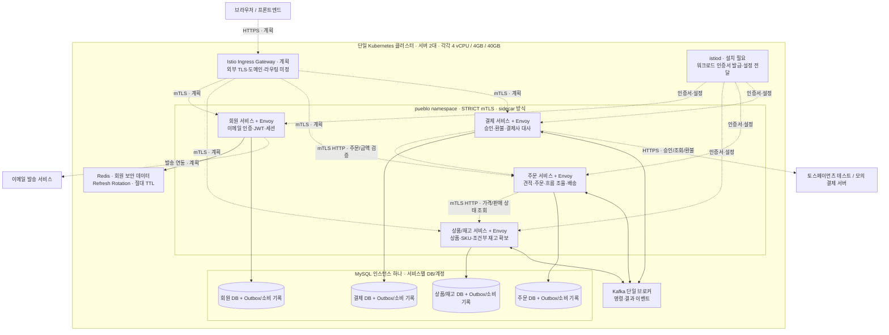

# pueblo 백엔드 서비스 아키텍처

작성일: 2026-10-24. 사용자 결정에 따라 단일 Kubernetes 클러스터에 Istio mTLS를 포함한다. 이 문서는 목표 구조와 현재 구현을 구분한다. 멀티클러스터·east-west gateway는 후속 실험이다.

회원 인증의 Redis 회전·TTL과 5분 액세스 정책은 [보안 적용 문서](security.md)를 따른다.

## 목표 논리 구성

서비스 기동·메시징 인프라는 구현했지만, 그림의 업무 기능·HTTP 호출·업무 이벤트 연결은 설계 단계다. Istio 배포 리소스는 저장소에 작성했으며 실제 클러스터 설치·주입·TLS handshake는 아직 검증하지 않았다. 데이터 노드의 배치·영속 스토리지·TLS는 별도 결정이다. 그림의 DB/Kafka 연결선이 Istio mTLS까지 적용됐다는 의미는 아니다.

## 서비스 책임

| 서비스 | 소유 데이터와 처리 |
| --- | --- |
| 회원 | 회원·이메일 인증·약관·로그인 세션·토큰 교체·비밀번호 재설정 |
| 상품/재고 | 브랜드·카테고리·상품·SKU·가용 재고·예약·해제·복원 |
| 주문 | 견적·주문/주소/금액 스냅샷·진행 상태·배송, 장바구니·관심목록 배치 제안 |
| 결제 | 결제 시도·승인·환불·웹훅·대사·운영자 확인 기록 |

다른 서비스 DB를 직접 조회·수정하지 않는다. 업무 변경과 Outbox를 같은 로컬 트랜잭션으로 저장하고, DB 폴러가 Kafka로 발행한다. 소비자는 중복 기록과 업무 변경을 함께 커밋한다. 서비스 간 분산 DB 트랜잭션은 사용하지 않는다.

## 주문·결제 흐름

1. 주문 서비스가 상품 서비스의 가격·판매 상태로 5분 견적을 만든다.
2. 주문 접수에서 가격을 재검증하고 준비 중 주문·재고 예약 명령을 저장한 뒤 `202`를 반환한다.
3. 상품/재고 서비스가 모든 SKU를 조건부 UPDATE로 확보하고 결과를 발행한다. 예약 성공부터 15분 동안 결제할 수 있다. 주문 준비는 30초 안에 결과가 없으면 중단한다.
4. 결제 서비스가 권위 있는 주문·금액·소유권을 확인한 뒤 결제사 승인을 즉시 요청한다. 결과와 이벤트를 보존한다.
5. 주문 서비스가 결제 성공 결과를 받아 재고 확정을 요청한다. 결제와 재고 확정을 모두 확인해야 출고할 수 있다.
6. 승인 결과가 불명확하면 결제사 대사로 복구한다. 예약 만료 후 늦은 승인은 재고 재확보를 시도하고 실패하면 전액 환불한다.
7. 취소와 출고는 주문 서비스에서 먼저 확정된 처리를 우선한다. 출고 전 환불 성공 후 재고를 한 번만 복원한다.

HTTP 호출은 상대 서비스의 Envoy를 통해 mTLS로 전달한다. Kafka 명령·결과 이벤트의 보호는 브로커의 배치·프록시 참여·클라이언트 인증 방식에 맞춰 별도 설계한다. 메시징 정합성은 mTLS와 별개로 Outbox·멱등 소비·대사로 확보한다.

## 인증 경계

| 구간 | 책임 |
| --- | --- |
| 브라우저 → 외부 진입점 | HTTPS, JWT·쿠키·CSRF·회원 소유권 검증. 진입점 구성 미정 |
| 서비스 Envoy ↔ 서비스 Envoy | Istio STRICT mTLS, 서비스별 ServiceAccount 기반 워크로드 신원 |
| Envoy → 같은 Pod의 Spring | 내부 HTTP. Spring에 별도 서버 인증서·keystore를 추가하지 않음 |
| Spring의 업무 처리 | 회원 JWT·운영자 권한·소유권 검사 유지. mTLS 신원만으로 회원으로 간주하지 않음 |
| MySQL·Kafka | DB 계정·브로커 인증·전송 TLS는 별도 구성. 현재 Compose는 로컬 개발용 |
| 결제사·메일 외부 호출 | 제공사 HTTPS·인증 수단 사용. Istio 인증서를 외부 인증 수단으로 전송하지 않음 |

mTLS는 호출자의 워크로드 신원을 확인하고 통신을 보호한다. 서비스 간 허용 호출·API 경로는 `AuthorizationPolicy`로 별도 제한할 수 있으나 아직 계약이 미정이라 이 배포 기반에는 추가하지 않았다. 현재 Spring 업무 경로는 인증 구현 전까지 차단 상태다.

## 실제 서버 배치

노드별 control plane·MySQL·Kafka·앱 배치는 아직 확정하지 않았다. 각 서비스는 초기 1개 replica로 설정했고 proxy 자원 요청·제한을 포함했다. 두 앱 인스턴스의 경합 검증 시 대상 서비스 replica를 늘려 다른 노드 배치 여부를 확인한다. 단일 replica·공유 DB·단일 Kafka를 고가용성으로 간주하지 않는다.

## 관련 파일

- [설계 결정과 미정 항목](backend-design.md)
- [Outbox 구현과 검증](messaging.md)
- [Istio 설정·배포 전제·검증](istio-mtls.md)
- [Kubernetes 기본 리소스](../infra/k8s/base/kustomization.yaml)
