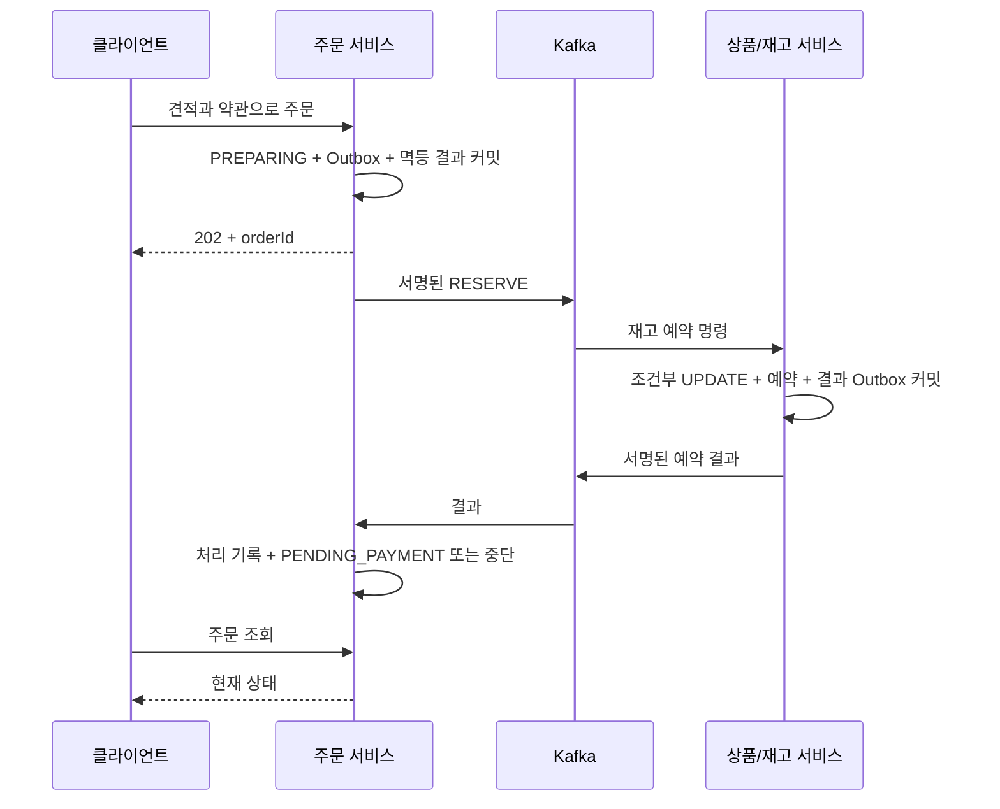

# 주문 접수와 재고 예약

## 구현 범위

주문 서비스가 회원 API로 인증하고, 상품 API로 가격을 확인한 뒤 자기 MySQL DB에 견적·주문·멱등 결과·Outbox를 저장한다. 상품/재고 서비스는 Kafka 명령으로 재고를 확보하고 결과를 전달한다. 서로의 DB나 도메인 구현을 직접 참조하지 않는다.

`PENDING_PAYMENT`는 재고 확보 완료를 뜻한다. 이후 [결제 시도 접수](order-payment-preparation.md)를 활성화하면 `PAYMENT_PROCESSING`으로 전환하며 일반 취소를 차단한다. 처리 중 예약 만료는 `RECONCILIATION_REQUIRED`로 보존하고 재고를 해제한다. 실제 PG 승인·결제 UI·환불·출고·장바구니 정리는 아직 연결하지 않았다.

## 실행

기존 `.env`에 다음 값을 직접 설정한다. 비밀 값은 저장소에 넣지 않는다.

```dotenv
ORDER_FLOW_ENABLED=true
INVENTORY_ENABLED=true
INVENTORY_LISTENER_ENABLED=true
INVENTORY_EXPIRY_ENABLED=true
INVENTORY_COMMAND_SECRET=<32바이트 이상의 별도 무작위 비밀>
ORDER_TERMS_VERSION=purchase-v1
```

`INVENTORY_COMMAND_SECRET`은 JWT 키와 별개다. 주문과 카탈로그에 동일하게 주입한다. 두 서비스가 켜져 있어도 이 옵션들은 기본 비활성이다. `.env.example`을 참고하고 설정 후 `docker compose up -d --build catalog-service order-service`로 반영한다. 회원 서비스와 MySQL·Kafka도 실행되어 있어야 한다. 개발 상품은 기존 카탈로그 가져오기 절차로 준비한다.

Compose는 `ORDER_MEMBER_URL=http://member-service:8080`, `ORDER_CATALOG_URL=http://catalog-service:8080`을 주입한다. 호스트에서 실행하면 각각 localhost:8081/8082가 기본값이다. Kubernetes는 해당 Service DNS를 사용한다. HTTP는 localhost/loopback 또는 해당 서비스 이름·Kubernetes 서비스 DNS만 허용하고, 그 외 호스트는 HTTPS가 필요하다. 사용자 입력으로 대상 URL을 받지 않고 리다이렉트도 따르지 않는다.

Istio 환경의 앱 간 HTTP는 기존 sidecar/STRICT mTLS로 보호한다. 이 설정만으로 Kafka까지 암호화되는 것은 아니다. 운영 브로커에는 TLS/SASL/토픽 ACL을 별도로 적용해야 한다. 현재 클러스터 배포·트래픽 검증은 미실행이다.

## API

모든 API는 `Authorization: Bearer <로그인 accessToken>`이 필요하다. 주문 서비스는 매 요청마다 회원 서비스의 `GET /api/v1/me`로 JWT·DB 세션·Redis 폐기 상태를 확인한다. 회원 서비스 장애 시 503으로 닫으며 토큰을 캐시하지 않는다. 주문에는 회원 쿠키를 전달하지 않으며 CSRF를 비활성화했다. CORS origin은 `AUTH_ALLOWED_ORIGINS`, credentials는 false다. 로그아웃 직후 신규 요청은 회원 서비스가 거부하지만 이미 인증을 통과해 진행 중인 요청을 소급 중단하지는 않는다.

| 메서드 / 경로 | 결과 |
| --- | --- |
| `POST /api/v1/checkout/quotes` | 201, 5분 견적. 재고 예약 없음 |
| `POST /api/v1/orders` | 202, PREPARING 주문·명령 Outbox 영속화 |
| `GET /api/v1/me/orders` | 본인 목록. page 1부터, size 기본 20·최대 100 |
| `GET /api/v1/me/orders/{id}` | 본인 주문 스냅샷·현재 상태 |
| `POST /api/v1/me/orders/{id}/cancellations` | 202, 미결제 취소 접수. 본문 불필요 |

견적 요청:

```json
{
  "items": [{"productId": "상품 UUID", "skuId": "SKU UUID", "quantity": 1}]
}
```

입력은 최대 20개이며 같은 SKU 수량을 합산해 9개 이하로 제한한다. SKU별 구매 상한·판매 상태도 확인한다. 통화는 KRW, 배송비·쿠폰·수수료는 이번 범위에 없고 서버 단가×수량 합계만 계산한다. 견적 응답의 `quoteId`, `items`, `totalAmount`, `currency`, `expiresAt`을 표시한다.

주문 요청에는 `Idempotency-Key` 헤더(영문·숫자·`._:-`, 1~128자)가 필요하다.

```json
{
  "quoteId": "발급된 견적 UUID",
  "shipping": {
    "recipient": "테스트 수령인",
    "phone": "01012345678",
    "postalCode": "12345",
    "address1": "테스트 배송지",
    "address2": "상세 주소"
  },
  "purchaseTermsVersion": "purchase-v1",
  "agreed": true
}
```

약관 버전과 서버 동의 시각을 보존한다. 배송지는 형식 검증만 하며 실제 배송 가능 지역/주소 조회는 아직 없다. 같은 회원·키·본문 재시도는 최초 202 응답을 반환하므로 **현재 상태는 주문 조회 API**로 확인한다. 같은 키·다른 본문은 409다. 한 견적은 한 주문에만 사용한다. 멱등 기록은 주문과 함께 보존하며 현재 자동 삭제하지 않는다. 보관 기간·개인정보 파기 운영 정책은 실제 판매 전 확정해야 한다.

조회하지 못한 타인 주문·견적은 404, 품절/상한/가격 변경은 409, 견적 만료는 410이다. 오류는 공통 `ErrorCode`와 한국어/영어 응답을 사용한다. Swagger는 기능 활성화 후 `http://localhost:8083/swagger-ui/index.html`에서 확인한다.

## 정합성



- HTTP 가격 조회와 주문 DB 트랜잭션을 분리한다. 접수 전 가격을 재조회하고, 그 이후 가격 변경은 예약 명령의 `expectedUnitPrice`를 카탈로그 조건부 UPDATE에서 검사한다. 달라졌으면 `PRICE_CHANGED`로 예약 전체를 거부하며 새 견적이 필요하다. 재고 확보 이후에는 주문 스냅샷 단가를 유지한다.
- 예약 성공은 확보 시점부터 15분이다. 접수 후 30초 내 결과를 반영하지 못하면 `ABORTING`으로 전환하고 해제 명령을 Outbox에 기록한다. 1초 주기 작업은 재시작 후에도 DB의 만료 대상을 찾는다.
- 사용자 취소는 `ABORTING → CANCELED`, 준비 시간 초과는 `ABORTING → REJECTED`, 미결제 만료는 `ABORTING → EXPIRED`다. 해제·만료·예약 거부 결과를 확인해야 중단이 완료된다. 늦은 예약 성공이 중단 주문을 되살리지 않는다.
- 카탈로그가 먼저 예약 만료를 확인하면 결과로 주문을 `EXPIRED` 처리한다. 명령/결과 순서 대신 예약 ID·세대·원장 버전으로 오래된 결과를 걸러낸다. 해제가 먼저 도착하면 카탈로그 tombstone으로 후속 예약을 거부한다.
- 명령은 주문번호를 Kafka key로 사용한다. Outbox의 원래 이벤트 ID를 재사용하고 두 방향 모두 HMAC-SHA256 헤더를 검증한다. 결과 헤더는 `pueblo-inventory-result-signature`, 명령은 `pueblo-inventory-signature`다. 결과 이벤트 ID 중복은 DB 처리 기록으로 제거하고 동일 ID·다른 내용은 거부한다.
- 예상하지 못한 확정/복원 결과는 `RECONCILIATION_REQUIRED`로 남긴다. 아직 결제 결과로 해석하지 않는다.
- 소비 오류는 기존 정책대로 컨슈머를 멈추고 offset을 넘기지 않는다. readiness는 리스너 중단을 DOWN으로 표시한다. Outbox 재시도 소진/소비 중단은 운영자가 원인 확인 후 복구해야 한다. `ABORTING`을 임의로 성공으로 바꾸지 않는다. 자동 DLQ·운영 재처리 API는 후속 범위다.

## 검증

```sh
./gradlew :order-service:test :order-service:integrationTest :catalog-service:integrationTest :messaging-jdbc:integrationTest
```

통합 테스트는 실제 MySQL 8.4.7·Kafka 4.1.2에서 카탈로그와 주문 앱을 별도 실행하고 DB와 계정도 분리한다. 회원 API는 계약 스텁을 사용하므로 이 테스트만으로 실제 회원 JWT 암호 검증을 검증했다고 주장하지 않는다. 회원 JWT·Redis 세션 검증은 기존 회원 테스트의 범위다. 실제 SMTP·실제 결제·사용자 로컬 DB는 사용하지 않는다.

실행 결과(2026-10-25): 주문 통합 12건, 카탈로그 조회 8건, 재고 12건, 메시징 12건 통과. 주문 테스트에는 정상 예약/취소, 인증·소유권·멱등·견적 만료, 접수 전/예약 전 가격 변경, 마지막 재고 경합, 늦은 결과, 결과 중복·서명 거부, 미결제 만료, 재시작 복구, 해제 선도착, Kafka 중단·복구, Outbox 실패 롤백, 수량·약관·금액 위조 검증이 포함된다. 재고 기존 100건/2개 앱 경합은 1건 확보·최종 재고 0이었다. 이 수치는 실제 두 서버 부하 시험 결과가 아니다.
